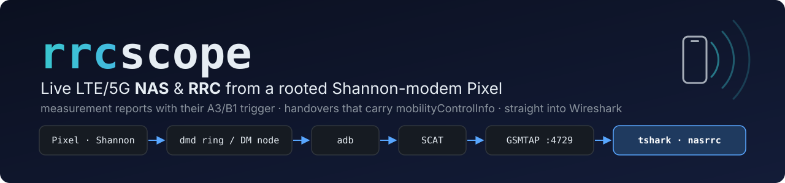
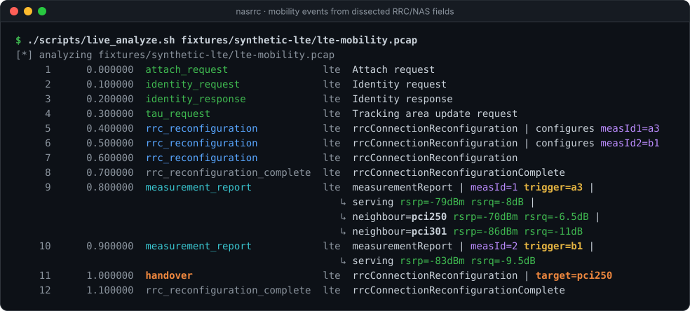
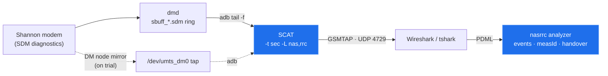

<p align="center">
  
</p>

<p align="center">
  <a href="https://github.com/alirafiqmalik/rrcscope/actions/workflows/tests.yml"></a>
  
  
  
  
</p>

<p align="center">
  <a href="#quickstart">Quickstart</a> ·
  <a href="#how-it-works">How it works</a> ·
  <a href="#documentation">Documentation</a> ·
  <a href="docs/findings.md">Device findings</a> ·
  <a href="research/lte-attach-capture/README.md">Attach study</a>
</p>

**rrcscope** streams the cellular control plane of a rooted Google Pixel to
Wireshark while you use the phone: every LTE and 5G NR **NAS** and **RRC** message
from its Samsung Shannon modem. It also tells you what those messages mean for
mobility: which measurement event fired, at what RSRP/RSRQ, and whether a
reconfiguration really was a handover.

> [!WARNING]
> Use it only on a phone and SIM that you own or are authorized to test. Raw
> captures contain your IMSI, IMEISV, location, and SMS. They are git-ignored by
> default. See [SECURITY.md](SECURITY.md).

<p align="center">
  
</p>
<p align="center"><sub>Real output of <code>./scripts/live_analyze.sh fixtures/synthetic-lte/lte-mobility.pcap</code>. A live session prints the same lines as the messages arrive.</sub></p>

## Highlights

- **Live until Ctrl-C.** It follows the modem logger's rotating ring across rotations,
  and it restores the phone's logging state on exit, also after a second Ctrl-C.
- **Real handovers only.** A reconfiguration is called a handover only when it carries
  `mobilityControlInfo` (LTE) or `reconfigurationWithSync` (NR). The Info column
  cannot show this difference.
- **Measurement reports with context.** The A3/B1/… trigger of each measId is
  learned from the earlier `measConfig`. RSRP/RSRQ/SINR are converted to dBm/dB
  per 36.133 / 38.133, and every EN-DC serving MO is reported.
- **Development without a phone.** You can replay a saved `.sdm`, or use the
  hand-encoded synthetic pcap. Neither needs capture privileges.
- **Small and measured.** The analyzer uses only the standard library plus `tshark`.
  First packet in 2.75 s on the ring path. Median inter-arrival of 44 ms on the
  experimental DM-node tap ([findings](docs/findings.md)).

## How it works



The Pixel's modem writes **SDM** diagnostics, not Qualcomm DIAG, so DIAG-based
tools such as MobileInsight and QCSuper cannot read it. [SCAT](https://github.com/fgsect/scat)
can decode SDM. The hard part is getting a live SDM stream off the phone: `dmd`
owns the DM session, and the logger allows about one session per boot. rrcscope
reads what `dmd` already produces, decodes it on the host, and does the analysis on
tshark's dissected fields.

| Live path | Script | Latency | Status |
|---|---|---|---|
| Follow the dmd session ring | [`live_tail_ring.sh`](scripts/live_tail_ring.sh) | first packet 2.75 s, then bursts every 5–30 s | stable default |
| Read-only tap on the DM node, next to dmd | [`experiment_scat_diag.sh node`](scripts/experiment_scat_diag.sh) | median 44 ms | on trial ([ticket 04](.scratch/live-analyzer/issues/04-node-tap-as-live-path.md)) |

The full design, with state and sequence diagrams, is in [docs/architecture.md](docs/architecture.md).

## Quickstart

**You need:** Linux with `adb`, `tshark`, and Python ≥ 3.10. For live capture you
also need a rooted Pixel with a Shannon modem (tested on a Pixel 7a. Other Tensor
Pixels use the same modem family but are not tested).

```bash
git clone https://github.com/alirafiqmalik/rrcscope.git && cd rrcscope
./scripts/setup_venv.sh                      # .venv with SCAT (signalcat) + nasrrc
```

**1 — Try it without a phone:**

```bash
./scripts/live_analyze.sh fixtures/synthetic-lte/lte-mobility.pcap
```

**2 — Stream live from the phone** (USB debugging on, `adb shell su -c id` works):

```bash
./scripts/live_tail_ring.sh                  # terminal 1 · Ctrl-C to stop and restore
./scripts/live_analyze.sh                    # terminal 2 · mobility events from lo
```

or open the raw stream in Wireshark/tshark:

```bash
tshark -i lo -f 'udp port 4729 and dst host 127.0.0.1' \
       -Y 'gsmtap || lte_rrc || nas-eps || nr-rrc || nas-5gs'
```

**3 — Keep a capture and analyze it later:**

```bash
./scripts/capture_nas_rrc.sh captures/run1   # pull the current ring → cap.sdm
./scripts/decode_nas_rrc.sh captures/run1/cap.sdm
./scripts/live_replay_sdm.sh --analyze captures/run1/cap.sdm
```

> [!TIP]
> - Add `--json` for one JSON object per event, or `--kinds` for counts.
> - Add `--airplane` to `live_tail_ring.sh` for one forced detach/re-attach.
> - Plan one live run per boot. After logging stops, the phone's logger does not
>   start again until a reboot.
> - Capture on `lo` goes through `dumpcap` and needs capture rights. Reading a
>   pcap or a FIFO does not, and `--analyze` uses this.

## Documentation

The docs are hierarchical. Each part of the repo has a README next to its code:

| Part | README | What is in it |
|---|---|---|
| Host & device scripts | [scripts/README.md](scripts/README.md) | Each script, its flags and environment variables, the on-phone helpers |
| Analyzer package | [src/nasrrc/README.md](src/nasrrc/README.md) | CLI, Python API, event schema and kinds, dBm conversions |
| Architecture | [docs/architecture.md](docs/architecture.md) | Both live paths, SCAT parser selection, radio filtering, analyzer state |
| Device findings | [docs/findings.md](docs/findings.md) | Measured latency and throughput, platform limits, results on live data |
| Research | [research/README.md](research/README.md) | Frozen studies, e.g. an [LTE attach with per-message protection](research/lte-attach-capture/README.md) |
| Tests | [tests/README.md](tests/README.md) | What each suite proves, without a device |
| Fixtures | [fixtures/README.md](fixtures/README.md) | The hand-encoded synthetic pcap, frame by frame |

## Repository layout

```text
rrcscope/
├── scripts/            host scripts (bash) · device/ on-phone helpers (sh)
├── src/nasrrc/         analyzer package and CLI — stdlib + tshark
├── tests/              unittest + shell suites with a fake adb and a fake SCAT
├── fixtures/           synthetic GSMTAP pcap + a real attach summary (no identifiers)
├── research/           frozen capture write-ups
├── docs/               architecture, findings, design history, images
└── .scratch/           ADRs, spec, tickets, and the engineering log
```

## Tested on

| Device | Modem | Build | Decoder | Dissector |
|---|---|---|---|---|
| Pixel 7a (`lynx`), rooted | Exynos Modem 5300 (`g5300q`) | Android `user` | SCAT / signalcat 2.0 | Wireshark 4.7.2 |

If you run it on another phone, please send a
[device report](https://github.com/alirafiqmalik/rrcscope/issues/new?template=device-report.yml),
whether it works or not.

**Known limits:** about one logging session per boot. SCAT sends some NR frames as
GSMTAPv3, which Wireshark shows as `Unknown GSMTAP version (3)` (the
display filter keeps bare `gsmtap` so that you still see them). USB DM (`scat -u`)
is blocked on `user` builds. More detail is in [docs/findings.md](docs/findings.md#constraints-of-the-platform).

## Related projects

- [fgsect/scat](https://github.com/fgsect/scat) — the SDM/DIAG decoder that rrcscope uses.
- [P1sec/QCSuper](https://github.com/P1sec/QCSuper) — live GSMTAP capture for Qualcomm modems.
- [mobile-insight/mobileinsight-core](https://github.com/mobile-insight/mobileinsight-core) —
  on-device analyzers for Qualcomm DIAG. rrcscope ports its analyzer *ideas* to the Shannon path.

## Citing

If this helps your research, use GitHub's **Cite this repository** button (from
[CITATION.cff](CITATION.cff)).
