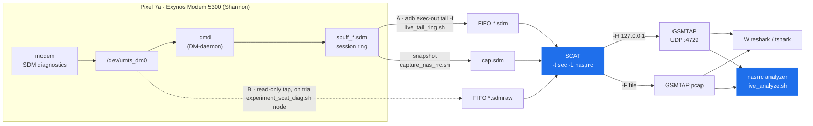
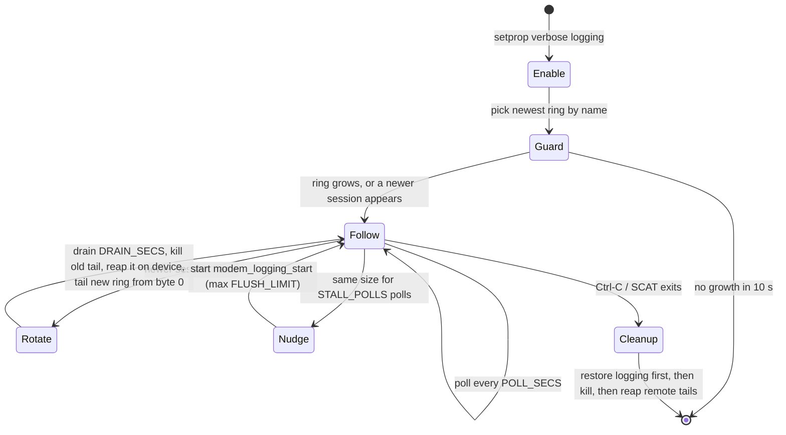
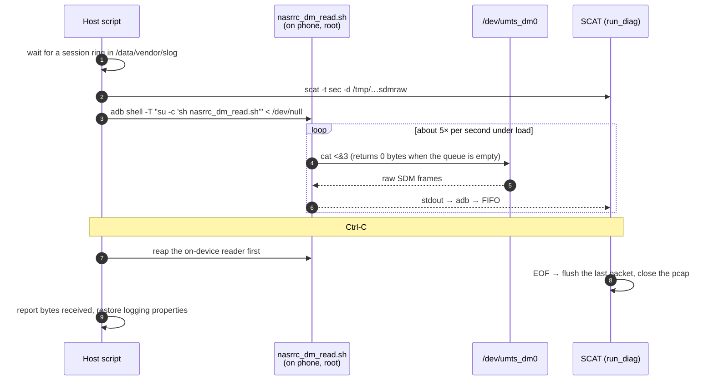
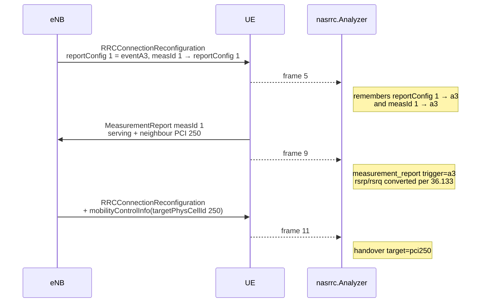
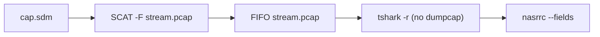

# Architecture

[← Docs index](README.md) · [← Project README](../README.md)

How a NAS/RRC message gets from the Shannon modem in a Pixel to a line on your
terminal. The short version is in the [project README](../README.md#how-it-works);
this page shows each stage and the reason it has its current shape.

- [End-to-end pipeline](#end-to-end-pipeline)
- [Live path A — follow the dmd ring](#live-path-a--follow-the-dmd-ring)
- [Live path B — tap the DM node](#live-path-b--tap-the-dm-node)
- [How SCAT picks a parser](#how-scat-picks-a-parser)
- [Which radio you see](#which-radio-you-see)
- [The analyzer](#the-analyzer)
- [Running without capture rights](#running-without-capture-rights)

## End-to-end pipeline



Three things are fixed by the device, and the rest follows from them:

1. **The modem speaks SDM, not Qualcomm DIAG.** So the decoder is
   [SCAT](https://github.com/fgsect/scat) in Samsung mode (`-t sec`), and tools
   built on DIAG (MobileInsight, QCSuper) do not apply.
2. **`dmd` owns the DM session.** It starts the session over a vendor RIL path
   (`liboemservice.so`, `COMMAND_SET_DM_MODE`), not by writing to the node. SCAT
   cannot start one itself: its `init_diag` frames reach the modem and get no
   answer. So both live paths read what dmd already produces.
3. **The logger allows about one session per boot.** After
   `start modem_logging_stop`, nothing brings logging back until a reboot. Every
   script restores the device on exit, and none stops the session by accident.

## Live path A — follow the dmd ring

[`scripts/live_tail_ring.sh`](../scripts/live_tail_ring.sh) — the stable default.

dmd writes a timestamped session ring (`sbuff_<YYYYMMDDhhmmss>.sdm`) under
`/data/vendor/slog/` and then rotates it into `/data/vendor/radio/logs/always-on/`.
The script streams the newest ring over `adb exec-out tail -c +1 -f` into a FIFO
whose name ends in `.sdm`, and SCAT decodes the FIFO as an always-on log.



The details that make it work, all found on the device:

| Problem | What the script does |
|---|---|
| `tail -f` never returns on a ring that stopped growing, so the stream stayed on the first ring and died at the first rotation. | The remote tail runs in the background and is swapped when a newer session name appears. |
| `ls -1t` is mtime order, and a ring that is still flushing can outrank the session that replaced it. | Rings are chosen by **name**, so the follower only moves forward. A backwards move would replay megabytes of history as fresh GSMTAP. |
| Killing `adb exec-out` on the host does not kill the `tail` on the phone. | The script reaps remote tails by pattern: on rotation only the old ring's tail, on start and stop all of them. |
| `adb_su` wraps its argument in single quotes, so a quoted `pkill -f` pattern became `pkill -f tail` and matched every `tail` on the phone. | The pattern has no spaces and no quotes (`tail.-c..1.-f./data/vendor/`). |
| A second Ctrl-C during teardown left verbose logging on. | `cleanup` restores logging **first** and ignores further INT/TERM. |
| A ring can rotate away between `ls` and `stat` (~9 s rotation interval). | A failed `stat` counts as size 0 instead of ending the run under `set -e`. |

SCAT logs one `Skipping packet as magic does not match` at each splice and then
resyncs, so SDM framing survives a rotation.

**Cost:** end-to-end lag is bounded by how often dmd flushes and rotates the ring.
Measured: 2.75 s from SCAT attach to the first packet, then bursts every 5.5–6.6 s
(and a ~30 s rotation cadence under a 52 MB ring).

## Live path B — tap the DM node

[`scripts/experiment_scat_diag.sh node`](../scripts/experiment_scat_diag.sh) — lower latency, on trial
([ticket 04](../.scratch/live-analyzer/issues/04-node-tap-as-live-path.md)).

`/dev/umts_dm0` **mirrors** its live SDM stream to a second reader while dmd holds
it. Nothing is taken from dmd: its ring grew from 14,685,987 to 20,981,219 bytes
during a 25 s window in which the tap read 9.1 MB.



Measured on an idle, stationary UE: median inter-arrival 44 ms, longest gap
8.1 s, first packet about 3 s after attach. A 60 s run with a session ring present
delivered 74,547,085 bytes.

Three traps this path must avoid:

- **`< /dev/null` is required.** With a terminal on stdin, `adb shell -T` gives the
  host zero bytes while the tap on the phone reads normally.
- **Gate on a session ring, not a property.** `vendor.sys.modem.logging.status`
  reads `true` while dmd is still filling `sbuff_power_on_log.sdm` (~10.5 MB), and
  during that time the node gives the tap nothing.
- **Stop the reader before SCAT.** SCAT then sees EOF and flushes. Killing SCAT first
  leaves a pcap that has only a header.

## How SCAT picks a parser

The file name decides the parser, so each FIFO has a name that selects the correct one:

| Input name | SCAT entry point | Used by |
|---|---|---|
| contains `.sdm` | `run_logger` — always-on logger framing | ring path, `capture_nas_rrc.sh`, replay |
| anything else, e.g. `.sdmraw` | `run_diag` — raw SDM frames | DM node tap |

Two flags are easy to confuse: `-H` sets the GSMTAP host, and `-a` is a USB
`bus:address`, not an IP address.

## Which radio you see

SCAT sends radio 0 to the configured GSMTAP host and a second radio (for example an
eSIM in the other slot) to the next address. The documented listener filters on
`dst host 127.0.0.1`, so you see the physical SIM only, and the scripts never
toggle the eSIM.

```bash
tshark -i lo -f 'udp port 4729 and dst host 127.0.0.1' \
       -Y 'gsmtap || lte_rrc || nas-eps || nr-rrc || nas-5gs'
```

The filter starts with bare `gsmtap` because SCAT emits some 5G NR frames as
**GSMTAPv3**, and Wireshark builds without a v3 dissector show them as
`Unknown GSMTAP version (3)`.

## The analyzer

[`src/nasrrc/`](../src/nasrrc/) has two classifiers:

| | `events.py` — summary classifier | `fields.py` — field analyzer |
|---|---|---|
| Input | tshark Info column (text) | tshark **PDML** (dissected tree) |
| Tells handover from reconfiguration | no | yes — `mobilityControlInfo` / `reconfigurationWithSync` |
| measId, trigger (A3/B1/…), RSRP/RSRQ/SINR | no | yes |
| Use for | quick counts of a summary file | everything else (`--fields`, live) |

Why PDML and not `tshark -T fields`: `lte-rrc.reportConfigId` occurs once per
`ReportConfigToAddMod` **and** once per `MeasIdToAddMod`. Flat output loses that
nesting, so the measId → event mapping cannot be recovered. PDML keeps the tree
and still streams packet by packet under `-l`, so one parser serves a pcap, a
FIFO, and a live interface.

The trigger for a measurement report is configured in an *earlier* message, so
the `Analyzer` keeps state across packets:



`measIdToRemoveList` is applied before the add list, as 36.331 specifies, so one
message can move a measId to a different reportConfig. An LTE reconfiguration that
carries an embedded NR reconfiguration (EN-DC) shows the nested `nr-rrc` as
`hide="yes"` in PDML. The analyzer skips hidden protocols, so the message stays
one LTE event.

See the [package README](../src/nasrrc/README.md) for the API, the event schema,
and the conversion formulas.

## Running without capture rights

`tshark -i lo` runs through `dumpcap`, which often needs the `wireshark` group.
Reading a file or a FIFO with `tshark -r` does not. The replay path uses this:



```bash
./scripts/live_replay_sdm.sh --analyze cap.sdm
```

To watch the live stream on a host with no capture rights, a plain UDP socket on
`127.0.0.1:4729` also works, because it needs no privileges.
