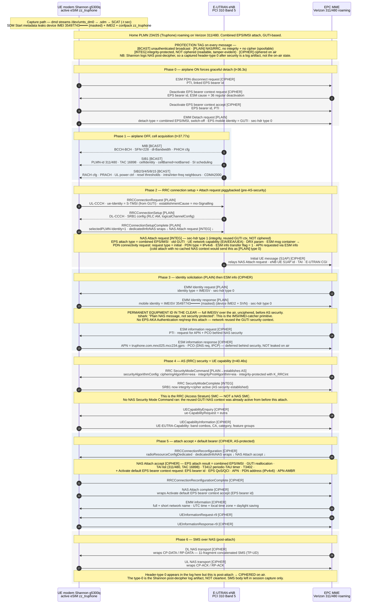

# Baseband NAS attach capture — Pixel 7a

[← Research index](../README.md) · [← Project README](../../README.md)

Frozen prior experiment. The maintained capture/decode/live scripts and classifier
live at the repo root ([`scripts/`](../../scripts/), [`src/nasrrc/`](../../src/nasrrc/)).
Handoff that started this repo: [`docs/live-analysis-handoff.md`](../../docs/live-analysis-handoff.md).

Live capture of the cellular modem's LTE Attach/Detach for the active eSIM, decoded
to NAS/RRC. Captured 2026-08-13 on the rooted Pixel 7a (Samsung Exynos Modem 5300,
Shannon/SIPC over PCIe). The [sequence diagram](#sequence-diagram) tags every message with its on-air protection.

## What was captured

An airplane-mode cycle drove a full detach then a full re-attach. SCAT decoded both
from the modem diagnostic stream. The re-attach is a **Combined EPS/IMSI Attach**,
home PLMN Truphone (234/25) roaming on Verizon (311/480), cell PCI 310 / Band 5 /
TAC 16898.

Message flow (relative times):

- t≈36.3s — airplane ON: PDN disconnect, Deactivate EPS bearer, EMM Detach (switch-off).
- t≈37.8s — airplane OFF: MIB/SIB acquisition, RRCConnectionRequest/Setup/SetupComplete
  carrying Attach request + PDN connectivity request.
- t≈37.8s — Identity request/response, then ESM information request/response.
- t≈40.5s — SecurityModeCommand/Complete, UE capability, Attach accept + Activate
  default EPS bearer, Attach complete, EMM information.
- post-attach — an 11-fragment SMS over NAS (CP-DATA/RP-DATA).

## Sequence diagram

Every message carries its on-air protection: `[BCAST]` unauthenticated broadcast,
`[PLAIN]` no integrity and no ciphering, `[INTEG]` integrity only, `[CIPHER]` ciphered.



## Two IMEI leak points, confirmed

The IMEI leaves the device on two independent channels:

- **Diagnostic stream.** Every SDM Start Response carries the device IMEI
  `35497743•••••••` (TAC shown, serial masked), IMEI2, and the active profile confpack `zz_truphone` in cleartext.
- **Over the air.** The NAS **Identity Response** carries the full **IMEISV**
  (`35497743••••••••`, device IMEI2 + software version) to the network. It is sent
  **before AS security**, unciphered. The network requested it with an Identity request
  of type IMEISV.

This attach reused the GUTI security context, so no EPS-AKA Authentication
request/response ran. The eNB still pulled the IMEISV in the clear.

## Cryptographic protection by message

Every message is tagged in the diagram with its on-air protection. The Shannon modem
logs NAS *after* deciphering, so a captured security-header type of 0 only means
"unprotected" for messages sent before security activates. After security is up, a
logged type-0 is a decode artifact, not the on-air state. The classes below reflect the
on-air state, cross-checked with tshark.

### No cryptographic protection — readable AND spoofable

No integrity, no ciphering. An on-air attacker reads these and a fake base station can
forge or solicit them. This is the pre-authentication surface that makes IMSI/IMEI
catchers and fake-eNB attacks possible.

| Message | Carries | Why unprotected | Attack it enables |
|---|---|---|---|
| MIB | SFN, DL bandwidth, PHICH config | BCCH broadcast, no sender auth | Fake eNB advertises a cell UEs will camp on |
| SIB1 | PLMN 311/480, TAC 16898, cellId, cellBarred | BCCH broadcast | Spoof PLMN/TAC to lure or trigger TAU |
| SIB2/3/4/5/8/15 | RACH, power control, reselection thresholds, neighbours | BCCH broadcast | Manipulate reselection to pull UEs onto a rogue cell |
| RRCConnectionRequest | S-TMSI, establishmentCause | UL-CCCH before AS security | Identity linkage by S-TMSI; connection spoofing |
| RRCConnectionSetup | SRB1 config | DL-CCCH before AS security | Rogue eNB completes the setup handshake |
| RRCConnectionSetupComplete | selectedPLMN, wraps NAS Attach request | sent before AS security | Carrier for the plaintext NAS below |
| EMM Detach request (switch-off) | detach type, GUTI | NAS sec-hdr type 0 (verified) | Forged detach — signalling denial of service |
| EMM Identity request (IMEISV) | identity type = IMEISV | NAS sec-hdr type 0 | Fake MME solicits the permanent equipment id |
| **EMM Identity response** | **full IMEISV `35497743••••••••`** | **NAS sec-hdr type 0, "Plain NAS, not security protected"** | **Harvest the permanent IMEI over the air — the IMEI-catcher primitive** |

The Identity Response is the sharp one: the network asked for the IMEISV and the UE
returned the full permanent equipment identity with zero protection, before AS security,
even though a NAS security context existed. Any active fake eNB can replay the Identity
request(IMEISV) and collect it. This is a second IMEI-exposure channel alongside the RSP
`deviceInfo` leak — one over the cellular air interface, one over the eSIM download.

### Integrity-protected, NOT ciphered — readable, tamper-evident

Contents are in the clear on air but signed, so an attacker reads them and cannot forge
them undetected.

| Message | Carries | Protection |
|---|---|---|
| NAS Attach request | attach type, old GUTI, UE network capability, DRX, PDN connectivity request (PDN type IPv4v6, ESM info flag) | NAS sec-hdr type 1 via reused GUTI context. A cold attach with no cached context sends this as type 0 — fully unprotected. |

The UE network capability (supported EIA/EEA algorithms) travels here in the clear. That
is the field a bidding-down attacker targets on a cold, type-0 attach.

### Ciphered on air — protected

Confidentiality plus integrity. Not readable on air (the log shows plaintext only because
Shannon decodes post-decipher): ESM information request/response (so the APN
`truphone.com.mnc025.mcc234.gprs` is NOT leaked), RRC SecurityModeCommand/Complete,
UE capability, NAS Attach accept + Activate default EPS bearer, Attach complete, EMM
information, and all SMS-over-NAS.

Note the SMC here is the **RRC (Access Stratum)** SecurityModeCommand. No NAS SMC ran —
the reused GUTI NAS context was already active.

## The test eSIMs do not attach

The enabled test profiles (Speedtest Travel, BetterRoaming — Truphone, simless/wildcard)
do not hold a cellular attach. The modem loops in LTE PHY cell search on PCI 310 with
marginal signal (RSRP −83 to −142 dBm) and never completes RRC. Steady-state data rides
IWLAN (Wi-Fi calling); CS/PS on WWAN read `NOT_REG_OR_SEARCHING`. The complete attach in
the capture belongs to the device's working roaming line, seen on the shared modem log.

## Reproduce

Use the repo-root scripts. Live stream until Ctrl-C: [`scripts/live_tail_ring.sh`](../../scripts/live_tail_ring.sh). Optional one-shot reattach: `--airplane`. Do not toggle eSIM profiles.

Modem is Samsung Shannon, not Qualcomm — use the SDM path, not DIAG/QMDL.

```bash
# 1. enable the silent modem logger (root)
adb shell su -c 'setprop persist.vendor.sys.modem.logging.enable true; \
  setprop vendor.modem.logging.shannon_logging true; start modem_logging_start'
# dmd now writes /data/vendor/slog/sbuff_*.sdm

# 2. optional: force a reattach (or pass --airplane to live_tail_ring.sh)
adb shell su -c 'cmd connectivity airplane-mode enable';  sleep 5
adb shell su -c 'cmd connectivity airplane-mode disable';  sleep 30

# 3. pull + decode (SCAT = fgsect/scat, pip name signalcat)
adb shell su -c 'cp /data/vendor/slog/sbuff_<ts>.sdm /data/local/tmp/; chmod 644 /data/local/tmp/*.sdm'
adb pull /data/local/tmp/<file>.sdm .
python3 -m scat.main -t sec -d <file>.sdm -F attach.pcap -L nas,rrc
tshark -r attach.pcap -T fields -e frame.time_relative -e _ws.col.Info

# 4. revert (root)
adb shell su -c 'setprop persist.vendor.sys.modem.logging.enable false; start modem_logging_stop'
```

## Scope and hygiene

Read-only diagnostic capture. No NV/EFS write, no OEM-hook/AT commands, no firmware
flash. Raw `.sdm`/`.pcap` hold real subscriber traffic (M-TMSI, IMEISV, SMS body) and
stay in the session scratchpad — they are not committed. Identifiers here are masked.
Device state was reverted: logger disabled, generated logs removed, both profiles
returned to Disabled.
